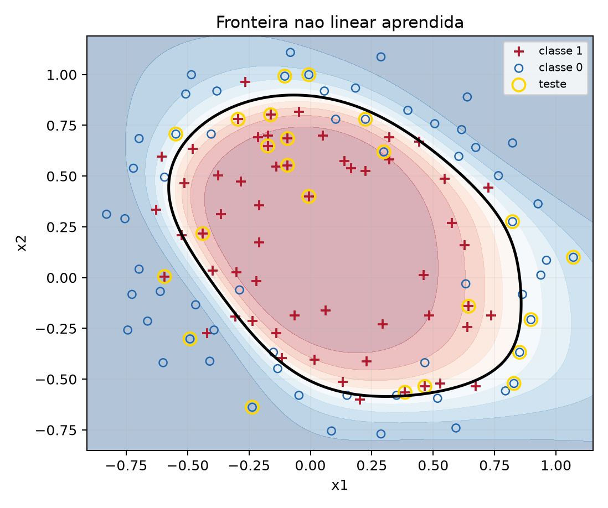
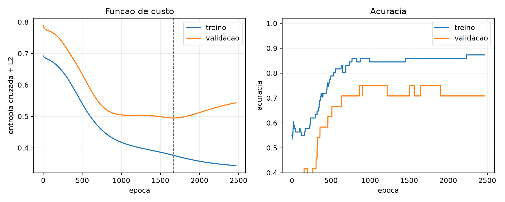

# Neural Networks from Scratch

## Project Overview

A binary multilayer classifier with manually implemented forward propagation, backpropagation and gradient descent. Includes a separate one-dimensional logistic regression exercise.

## Problem Statement

Learn a nonlinear decision boundary while making each gradient computation inspectable, without using an automatic differentiation framework.

## Technologies Used

Python 3.13, NumPy and Matplotlib. Jupyter/IPython for notebook presentation.

## Methodology

Stratified training/validation/test split; training-only standardization; Xavier initialization, tanh hidden layers, sigmoid output, binary cross-entropy, L2 regularization and early stopping. Eight configurations are selected using validation accuracy, loss and parameter count. The test split is used after selection.

## Architecture / Algorithms

Two or three hidden layers are supported. The selected model is **2 → 12 → 8 → 1**. A numerical gradient check compares all 44 parameters of a smaller probe network against central finite differences.

## Experimental Setup

118 numeric examples from the course dataset: 71 training, 24 validation and 23 test. Split seed 42. Selected learning rate 0.1 and L2 coefficient 0.001.

## Results and Evaluation

| Measure | Recorded value |
|---|---:|
| Test accuracy | 86.96% (20/23) |
| Test F1 | 0.8696 |
| Confusion counts | TN=10, FP=2, FN=1, TP=10 |
| Gradient relative error | 4.3355 × 10⁻¹¹ |

The gradient check was reproduced during preparation. The full eight-configuration training pipeline was also rerun during preparation and reproduced the saved classification metrics. See [all trials](resultados/backprop_resultados.json).





## Installation and Usage

```bash
pip install -r requirements.txt
python backprop_ml.py
```

Alternatively open [backprop.ipynb](backprop.ipynb), keeping `classification2.txt` beside it. The script and notebook both write to `resultados/` in this review copy.

## Limitations and Future Improvements

The test split has only 23 samples. A single split cannot establish population-level performance. Further work could add repeated splits and confidence intervals. The optional digit-classification application and the group-only second application were not implemented.

## Academic Context and Credits

UFSC Machine Learning, Prof. Eric Aislan Antonelo. The classifier and optimizer use NumPy operations rather than ready-made neural-network training. `classification2.txt` is course-provided data; dataset redistribution terms need review. AI assistance was disclosed in the original submission.

See [academic context](ACADEMIC_CONTEXT.md) and [publication review notes](PUBLICATION_NOTES.md).
